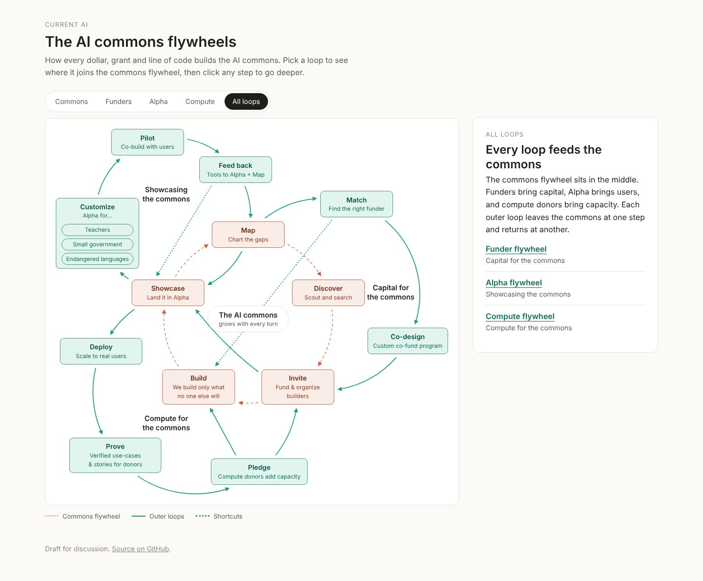

# The AI commons flywheels

An interactive explorer for Current AI's flywheels. The commons flywheel stays fixed in the middle. The outer loops (funders, Alpha, compute) switch in around it, and every step opens a short deep dive in the side panel.



## Look at it

Open `index.html` in a browser. There is no build step and nothing to install.

To serve it locally instead:

```sh
python3 -m http.server 8000
# then open http://localhost:8000
```

Every view has its own link, so you can send someone straight to a loop or a step:

- `#commons`, `#funder`, `#alpha`, `#compute`, `#all`
- `#compute/pledge`, `#alpha/customize`, and so on

## Change the words

Everything a reader sees lives in [`assets/data.js`](assets/data.js): step names, box subtitles, side-panel text, legend labels and links. Edit it and reload; the diagram redraws itself.

A few layout fields sit next to the words:

| Field | What it does |
| --- | --- |
| `sub` | Box subtitle, one string per line |
| `angle` | Where a commons step sits on its circle (degrees; -90 is the top) |
| `frac` | Where an outer-loop step sits along its loop (0 is the start, 1 the end) |
| `bulge` | How far an outer loop swings out from the commons flywheel |
| `w`, `h` | Box size, when the words need more than the default 150 × 54 |
| `label.at` | Where a loop's label ("Capital for the commons") sits |
| `extras` | Shortcut lines, such as "Funder backs a bet" |

If you lengthen a subtitle, widen its box (`w`) or split it over two lines and set `h: 72`.

## How it is built

- `index.html`: the page.
- `assets/data.js`: content and layout.
- `assets/geometry.js`: circle and arc maths. Each outer loop is an arc of a circle through the two commons steps it joins, so every loop reads as a clean circle.
- `assets/app.js`: draws the SVG, switches loops, fills the side panel and keeps the URL in step.
- `assets/styles.css`: styles, including dark mode and reduced motion.

Plain HTML, CSS and JavaScript, no dependencies.

## Publish it

In the repository settings, open **Pages**, choose **Deploy from a branch**, and pick `main` with the root folder. The site appears at `https://currentai-org.github.io/flywheels/`.
